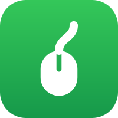

  

Your mouse dropped. Tether brings it back.

A Bluetooth mouse goes quiet and the keyboard is all you have left. Open Tether from Spotlight. It finds every saved copy of your mouse, calls them all at once, and tells you the second it's back. Press Return. Done.

## Get it

[Download Tether.zip](https://github.com/nulljosh/tether/releases/latest/download/Tether.zip), unzip, drag Tether to Applications. Signed and notarized, macOS 26 or later. Site: [tether.jaybulb.com](https://tether.jaybulb.com).

Or build it: `./build.sh` (needs Xcode 26).

## Features

No pointer needed. Tether starts connecting the moment it opens, and every button has a key. Return closes it, Escape too.

It never freezes. Each saved address gets its own thread, so a dead one can't hold up the live one. Most reconnects land in a second or two.

It knows your mouse. Any Bluetooth mouse or trackpad it sees connected, Tether remembers by name, so it finds it again after you re-pair.

It keeps trying. Leave it open and it watches the mouse. If the mouse drops again, Tether picks it right back up.

It tells you what to do. Mouse asleep? Turn it off and on. Never paired, or Bluetooth off? One key opens the right settings.

No account. No network. Nothing leaves your Mac.

## Development

One Swift file, no Xcode project. `./build.sh` compiles `Tether.swift`, compiles the icon from `Tether.icon`, signs, and installs to `/Applications`. The landing lives in `web/` and deploys with `npx wrangler deploy`.

## License

MIT
